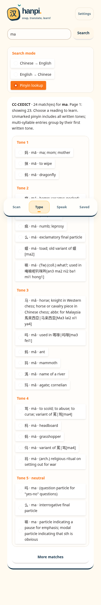
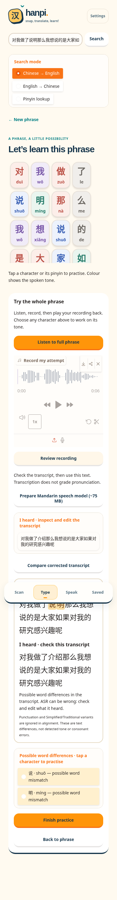

# Final phone feedback validation

- **92 tests passed**, including quieter stereo/phone-level synthetic tones, complete offline phrase/menu translation, unseen-sentence provider response, honest fallback labelling and homophone ASR handling.
- Chromium at 390×844 with **dark OS preference**: white audio background (`rgb(255,255,255)`) and navy text (`rgb(23,54,76)`), full 蒜香爆燒肉 translation, separate recording and sentence feedback stages, real Mandarin ASR, Back-to-previous-stage, no Settings/transcript-edit/model-download controls in the visible flow, and no page errors.
- User reported the previous build launched on the actual phone and recognized the actual menu image successfully. This pass's contrast/navigation checks are automated, not a new physical-phone test.
- Pronunciation changes were checked with synthetic contours and real ASR recordings. Human false-rejection rate and audible phone playback were not measured. No uncertain attempt is automatically declared correct.
- Current primary browser regression: `scripts/phone_release_smoke.cjs`; earlier walkthroughs below describe their respective revisions.

# Release reliability validation · 11 November 2026

This pass preserves the approved bubbly design and fixes lookup, dependency initialization, OCR review and sentence practice. The older redesign report below is historical.

- Baseline before this pass: **47 tests passed**.
- Current full suite: **82 passed, 0 failed, 0 skipped**, including the real bundled dictionary and packaged OCR models.
- A **fresh Python 3.11 venv** installed the main requirements and loaded 122,143 dictionary entries with UTF-8 mode disabled in an ASCII locale. The CP1252 failure in upstream pycccedict was reproduced against its real dataset; the explicit UTF-8 loader passes. This is not a real Windows OS/hardware test.
- `scripts/check_environment.py --strict --asr` passed in that same fresh interpreter, with the default Mandarin speech engine ready and optional Faster-Whisper absent.
- The release browser walkthrough passed at **390×844 and 1280×900**: offline `eat`, all-tone `ma`, numbered/accented lookup, selectable lessons, real online-provider denial with usable offline fallback, three-word phrase segmentation, editable OCR confirmation, real recorded Mandarin transcription, matching/mismatching target comparison and highlighted-character Spotlight. No page errors or horizontal overflow were observed.
- The existing browser walkthrough also passed: isolated-syllable synthetic tone feedback, retry/next/back, 60-character input, saved vocabulary/counter/reopen/remove, browser speech text/rate wiring and keyboard selection.
- Local authenticated startup passed: unauthenticated `/config` returned **401**, and valid login returned **200**. Test credentials were generated only in memory. This checks HTTP authentication, not a public HTTPS tunnel or actual iPhone.

## What was actually exercised

**Dictionary/search:** full installed CC-CEDICT, offline English reverse index, tone-aware pinyin index, paging and alternative readings retained into Spotlight and saved entries. Common starter vocabulary remains usable if full loading fails; the actual failure is logged and a repair/interpreter diagnostic is visible. Online-success logic is mocked in unit tests; the cloud browser exercised a real provider failure and fallback, not live fluent translation success.

**OCR:** actual RapidOCR ran on the committed generated 149×28 dark-red Traditional crop and large clean image. Both returned their complete expected text. The small fixture is deliberately similar in size/colour, but is **not the user's original image**. The original tiny crop and full menu were embedded inline in chat without a file path/download ID available to Python; exact-image benchmarking remains open. All recognized text must now be verified/edited before a lesson opens. Low-score readings are rejected; competing candidates remain selectable. No OCR text is hardcoded into the application.

**ASR:** installed sherpa-onnx 1.13.8 and the official compact 14M Mandarin Zipformer, downloaded from the [official release](https://github.com/k2-fsa/sherpa-onnx/releases/tag/asr-models). The 75 MB archive is pinned to SHA-256 `2cbd71b640d9c37d3784f29367333a4577b0398b62e9deeed418170b081cba8b`. Its Apache-2.0 release README supplies licensing. Public human Mandarin files `test_wavs/0.wav`, `1.wav`, and `8k.wav` were transcribed on CPU (about 0.15–0.84 seconds after/preparing the local engine in this environment). This is functional evidence, not an independent ASR accuracy study. The first public recording was uploaded through the browser recording control and compared both with a matching target and a target using 说明 instead of the recording's 介绍; flagged target characters opened Spotlight. These are real model calls, not mocked transcripts. The user's voice/microphone was not available.

**Truthful feedback:** punctuation and Simplified/Traditional variants are normalized only for text alignment. ASR mistakes are possible and the transcript is editable. A matching transcript explicitly does **not** verify pronunciation or tone. No per-word tone grade, consonant diagnosis or percentage score was introduced. The isolated-syllable F0 coach remains separate.

## Reproduce

```bash
python -m pip install -r requirements.txt pytest
python scripts/check_environment.py --strict
python scripts/prepare_asr.py
python scripts/check_environment.py --strict --asr
python -m pytest -q
```

Run the app with an isolated `HANPI_LIBRARY_PATH` for browser writes. The default local app needs no JavaScript build. For browser automation use the supplied Playwright/Chromium tooling:

```bash
HANPI_LIBRARY_PATH=/tmp/hanpi-release.sqlite3 python app.py
# In another terminal, provide the public release sample or another real Mandarin WAV.
HANPI_UI_URL=http://127.0.0.1:7860/ HANPI_SPEECH_SAMPLE=/path/to/real-mandarin.wav node scripts/release_smoke.cjs
node scripts/ui_smoke.cjs
```

`release_smoke.cjs` uses the official release's `test_wavs/0.wav` with the reference “对我做了介绍那么我想说的是大家如果对我的研究感兴趣呢”. A different WAV requires adapting that reference; do not call arbitrary speech a passed reference test. The existing smoke script generates its own image/synthetic pitch fixture. Both scripts require Playwright and Chromium; `HANPI_CHROMIUM` overrides the executable path. Screenshots are written to `HANPI_SCREENSHOT_DIR`.

## Current functional screenshots




## Remaining checks

- Original user menu image: add the actual file to the branch or supply a download URL, then benchmark the exact pixels and record output/candidates.
- Actual Windows environment and iPhone Safari camera/microphone, audible Mandarin TTS, and authenticated HTTPS sharing: use the five-minute checklist in PHONE_DEMO.md. Desktop viewport emulation is not a hardware pass.
- Live neural speech provider quality and optional Faster-Whisper model download remain unverified here. The default local Mandarin model does not require Hugging Face or a paid API.
- Native-speaker evaluation and submission demo. No permanent hosting or per-user cloud storage is claimed.

## Historical redesign QA

# Original Hanpi v1 redesign · historical QA

Validated locally on 11 November 2026 with Python 3.11.17, Gradio 6.31.0 and headless Chromium. The existing Python/Gradio stack, local OCR, dictionary, SQLite library and experimental pitch classifier are retained. No phoneme detector or whole-sentence tone grader was added.

## Results

- **Baseline:** 32 existing tests passed before changes.
- **Final Python suite:** 47 passed, 0 failed, 0 skipped (`python -m pytest -q`).
- **Startup:** Gradio UI import/build and the CI-equivalent local HTTP smoke test passed; Hanpi returned HTTP 200.
- **Browser walkthrough:** passed at 390 × 844 and 1280 × 900 with no page errors or horizontal overflow. See `scripts/ui_smoke.cjs`.
- **Persistence:** a saved 中国 entry survived an actual server stop/restart; its custom meaning and pinyin reopened correctly. The isolated test record was removed afterward.
- **Repository hygiene:** QA used a separate `HANPI_LIBRARY_PATH`; existing user vocabulary and remote authentication were preserved.

The browser walkthrough exercises:

1. Empty Scan error; a generated Chinese image → real RapidOCR → shared Results, dictionary gloss and vocabulary.
2. Distinct tone colours, aligned pinyin inside each accessible character control, Spotlight dimming, retry, next and return without losing the phrase.
3. All 60 characters of a long input, Chinese search and the explicit English-translation confirmation state.
4. Browser-speech callback text/rate, preserving the chosen 1.25× setting across navigation. The speech API is instrumented for this check; audible output is **not** verified.
5. A synthetic falling-tone WAV uploaded through the actual recording control → experimental matching-contour feedback → completion. This is not evidence of accuracy on human speech.
6. Saved phrase creation, a matching-practice counter, reload persistence, reopening, removal and repeated navigation to the current tab.
7. Whole-phrase recording/review's missing-audio state and explicit absence of sentence grading; Speak's missing-recording/transcript states.
8. Desktop layout and keyboard character selection. Screenshots use reduced motion for stable capture; the interface also disables animations when requested by the device.

Python regressions additionally cover saved-meaning invalidation when text changes, sandhi speech context, invalid selections, uncertain/mismatching practice counters, neural-service/protocol failure cleanup and browser fallback, the 1.25× rate, optional Whisper absence, and explicit English-to-Chinese translation direction. Live translation is mocked in those tests.

## Screenshots

Generated text and synthetic test fixtures only; no personal photos or recordings.


## Reproduce the browser check (Linux/cloud)

Run against an **isolated test database**, not a collection you use personally. Activate the Python venv first. No JavaScript build is required to run Hanpi itself.

Terminal 1:

```bash
HANPI_LIBRARY_PATH="$(mktemp -d)/library.sqlite3" MPLBACKEND=Agg python app.py
```

Terminal 2, from the repository root, with Node, Playwright, Chromium and a CJK font installed:

```bash
HANPI_SCREENSHOT_DIR=/tmp/hanpi-ui-evidence node scripts/ui_smoke.cjs
```

The managed cloud image already supplies Playwright, Chromium, FFmpeg and Noto CJK. Elsewhere, install Playwright into your development tooling (for example `npm install --prefix /tmp/hanpi-browser playwright`, then set `NODE_PATH=/tmp/hanpi-browser/node_modules`). Set `HANPI_CHROMIUM` to your Chromium executable and `HANPI_TEST_FONT` to a local CJK font if they differ from the Linux defaults. `HANPI_PYTHON` overrides `.venv/bin/python`; `HANPI_UI_URL` overrides the default local test server. The script generates its own OCR and synthetic WAV fixtures.

## Remaining device/service checks

- Actual iPhone Safari over authenticated HTTPS: rear camera, microphone permissions, real photo OCR and recorded syllables.
- Audible Mandarin browser speech and live neural TTS quality/availability. Network/provider restrictions can prevent neural audio; browser fallback remains available where supported.
- Live online translation and optional Whisper installation/model download/transcription.
- Native-speaker evaluation of experimental pitch feedback, Windows hardware validation and a submission demo.

No permanent deployment, per-user cloud storage or whole-sentence pronunciation accuracy is claimed. See `PHONE_DEMO.md` for the authenticated temporary HTTPS workflow.

> **Visual update notice (11 November, after the original QA run):** The screenshots below document the FIRST mobile-first redesign. A subsequent typography, palette, button and illustration refresh was pushed to the same branch. The 47-test / browser-walkthrough result described above predates those styling changes. Refer to [VISUAL_DESIGN.md](VISUAL_DESIGN.md) and run a fresh visual/browser check before treating these screenshots as an accurate preview.
