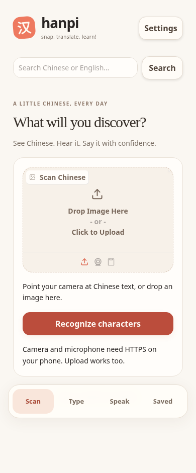
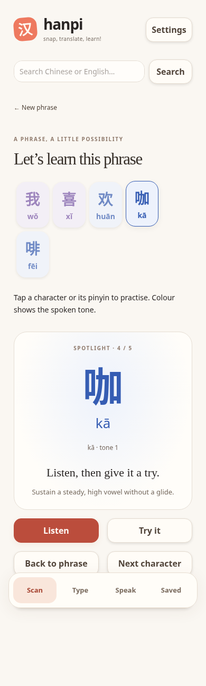
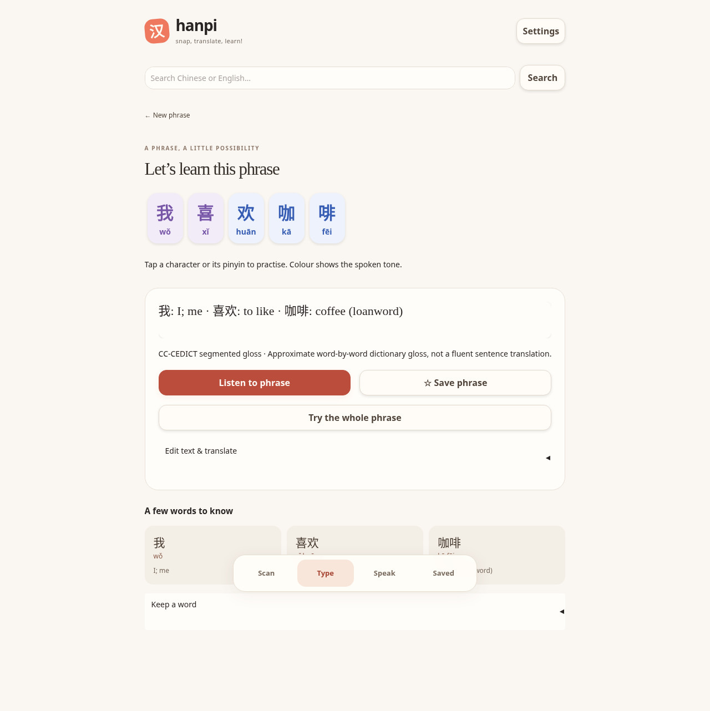

# Hanpi v1 redesign · QA evidence

Validated locally on 11 November 2026 with Python 3.11.17, Gradio 6.31.0 and headless Chromium. The existing Python/Gradio stack, local OCR, dictionary, SQLite library and experimental pitch classifier are retained. No phoneme detector or whole-sentence tone grader was added.

## Results

- **Baseline:** 32 existing tests passed before changes.
- **Final Python suite:** 47 passed, 0 failed, 0 skipped (`python -m pytest -q`).
- **Startup:** Gradio UI import/build and the CI-equivalent local HTTP smoke test passed; Hanpi returned HTTP 200.
- **Browser walkthrough:** passed at 390 × 844 and 1280 × 900 with no page errors or horizontal overflow. See `scripts/ui_smoke.cjs`.
- **Persistence:** a saved 中国 entry survived an actual server stop/restart; its custom meaning and pinyin reopened correctly. The isolated test record was removed afterward.
- **Repository hygiene:** QA used a separate `HANPI_LIBRARY_PATH`; existing user vocabulary and remote authentication were preserved.

The browser walkthrough exercises:

1. Empty Scan error; a generated Chinese image → real RapidOCR → shared Results, dictionary gloss and vocabulary.
2. Distinct tone colours, aligned pinyin inside each accessible character control, Spotlight dimming, retry, next and return without losing the phrase.
3. All 60 characters of a long input, Chinese search and the explicit English-translation confirmation state.
4. Browser-speech callback text/rate, preserving the chosen 1.25× setting across navigation. The speech API is instrumented for this check; audible output is **not** verified.
5. A synthetic falling-tone WAV uploaded through the actual recording control → experimental matching-contour feedback → completion. This is not evidence of accuracy on human speech.
6. Saved phrase creation, a matching-practice counter, reload persistence, reopening, removal and repeated navigation to the current tab.
7. Whole-phrase recording/review's missing-audio state and explicit absence of sentence grading; Speak's missing-recording/transcript states.
8. Desktop layout and keyboard character selection. Screenshots use reduced motion for stable capture; the interface also disables animations when requested by the device.

Python regressions additionally cover saved-meaning invalidation when text changes, sandhi speech context, invalid selections, uncertain/mismatching practice counters, neural-service/protocol failure cleanup and browser fallback, the 1.25× rate, optional Whisper absence, and explicit English-to-Chinese translation direction. Live translation is mocked in those tests.

## Screenshots

Generated text and synthetic test fixtures only; no personal photos or recordings.






## Reproduce the browser check (Linux/cloud)

Run against an **isolated test database**, not a collection you use personally. Activate the Python venv first. No JavaScript build is required to run Hanpi itself.

Terminal 1:

```bash
HANPI_LIBRARY_PATH="$(mktemp -d)/library.sqlite3" MPLBACKEND=Agg python app.py
```

Terminal 2, from the repository root, with Node, Playwright, Chromium and a CJK font installed:

```bash
HANPI_SCREENSHOT_DIR=/tmp/hanpi-ui-evidence node scripts/ui_smoke.cjs
```

The managed cloud image already supplies Playwright, Chromium, FFmpeg and Noto CJK. Elsewhere, install Playwright into your development tooling (for example `npm install --prefix /tmp/hanpi-browser playwright`, then set `NODE_PATH=/tmp/hanpi-browser/node_modules`). Set `HANPI_CHROMIUM` to your Chromium executable and `HANPI_TEST_FONT` to a local CJK font if they differ from the Linux defaults. `HANPI_PYTHON` overrides `.venv/bin/python`; `HANPI_UI_URL` overrides the default local test server. The script generates its own OCR and synthetic WAV fixtures.

## Remaining device/service checks

- Actual iPhone Safari over authenticated HTTPS: rear camera, microphone permissions, real photo OCR and recorded syllables.
- Audible Mandarin browser speech and live neural TTS quality/availability. Network/provider restrictions can prevent neural audio; browser fallback remains available where supported.
- Live online translation and optional Whisper installation/model download/transcription.
- Native-speaker evaluation of experimental pitch feedback, Windows hardware validation and a submission demo.

No permanent deployment, per-user cloud storage or whole-sentence pronunciation accuracy is claimed. See `PHONE_DEMO.md` for the authenticated temporary HTTPS workflow.
